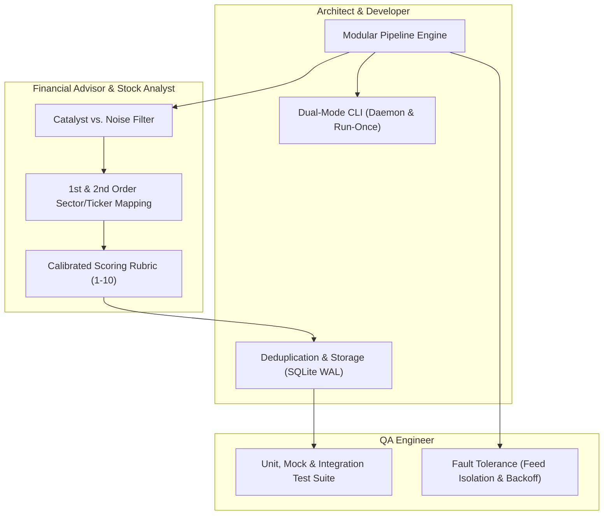
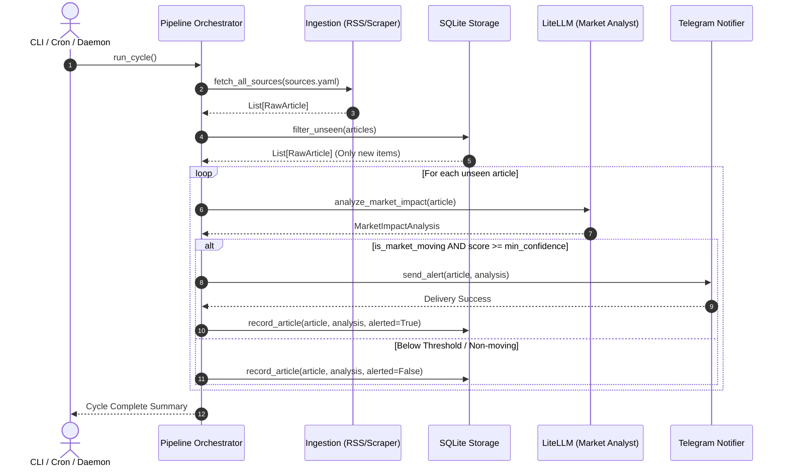

# Market News Analysis & Telegram Alert Agent — Design Specification

**Date**: 2026-10-17  
**Status**: Draft for User Review  
**Project Path**: `new-agent/`

---

## 1. Executive Summary & Goals

The **Market News Analysis Agent** is a periodic, automated intelligence system designed to ingest breaking financial and global news headlines, analyze them using LLM-powered market impact reasoning, assign confidence and severity grades, and deliver real-time push alerts to Telegram.

The project is structured under the `new-agent/` directory, adhering to modular software architecture, financial market analysis methodologies, and test-driven quality assurance.

### Key Objectives
* **Automated Periodic Ingestion**: Fetch headlines and summaries from a configurable list of top financial and news websites (RSS/Atom feeds with HTML scraping fallback).
* **Expert Financial & Stock Market Reasoning**: Distinguish market noise from high-impact market catalysts, determine 1st-order and 2nd-order stock/sector impacts, identify ticker symbols (e.g., `$AAPL`, `$NVDA`, `$XLK`), and assign calibrated confidence scores (1–10) and impact grades (`LOW`, `AVERAGE`, `HIGH`, `CRITICAL`).
* **Zero Duplicates**: Embedded SQLite storage (`WAL` mode) tracking content hashes, publication dates, and alert histories.
* **Instant Actionable Telegram Push Alerts**: Well-formatted, scannable markdown alerts highlighting urgency, affected tickers, sectors, thesis rationale, and source links.
* **Flexible Execution**: Dual-mode CLI running either as a continuous daemon (`--daemon --interval 15m`) for local/EC2/Docker deployment or a one-shot execution (`run-once`) for external cron/serverless triggers.
* **Extensibility**: Add new sources via YAML (`config/sources.yaml`) and new notification channels (e.g., Discord, Slack, Email) by implementing clean interfaces.

---

## 2. Expert Domain Architecture & Perspectives

To ensure high intelligence and production reliability, the system design synthesizes five domain disciplines:



### 2.1 Financial Advisor & Stock Analyst: Intelligence & Scoring Engine
Market news is 95% noise and 5% catalyst. The agent uses a prompt and schema engineered around institutional financial analysis principles:

1. **Catalyst Classification**:
   * **Tier 1 Catalysts (Critical, 9-10)**: Surprise regulatory/antitrust rulings, unexpected interest rate or monetary shocks, sudden major M&A announcements (> $5B), surprise CEO departures/fraud disclosures, war/sanctions disrupting critical global supply chains (e.g., Strait of Hormuz, Taiwan Strait).
   * **Tier 2 Catalysts (High, 7-8)**: Substantial earnings beat/miss with guidance revisions, FDA approval/rejection decisions for major pharmaceutical pipelines, significant export controls, major contract wins/losses affecting >10% of revenue.
   * **Tier 3 Noise / Neutral (Low/Average, 1-6)**: Routine analyst price target tweaks, recycled op-eds, general daily market recaps, minor executive hires, expected economic indicators matching consensus.

2. **Multi-Order Impact Analysis**:
   * **Primary (1st Order)**: Direct company impact (e.g., US restricts GPU exports -> Direct revenue hit to `$NVDA`, `$AMD`).
   * **Secondary (2nd Order)**: Supply chain and competitor spillover (e.g., Foundry volume drop for `$TSM`, downstream impact on server builders `$SMCI`, potential market share gain for domestic or alternative vendors).

3. **Ticker & Sector Disambiguation**:
   * Map affected companies to valid US exchange ticker symbols (with `$` prefix).
   * Map macro trends to GICS sectors (e.g., *Information Technology*, *Health Care*, *Financials*, *Energy*) and relevant ETFs (e.g., `$XLE`, `$SMH`, `$XLF`).

### 2.2 Software Architect: System Structure & Directory Layout
All code resides under `new-agent/`:

```text
new-agent/
├── config/
│   ├── settings.yaml          # Polling intervals, LLM model, alert thresholds
│   └── sources.yaml           # RSS feeds and website source definitions
├── src/
│   ├── __init__.py
│   ├── config.py              # Pydantic Settings & YAML loader
│   ├── models.py              # Shared data contracts (Article, ImpactAnalysis)
│   ├── ingestion/             # News fetchers
│   │   ├── __init__.py
│   │   ├── base.py            # BaseFetcher abstract class
│   │   ├── rss.py             # Feedparser RSS/Atom implementation
│   │   └── scraper.py         # Direct HTML/text scraper (Trafilatura fallback)
│   ├── storage/               # Deduplication & history
│   │   ├── __init__.py
│   │   ├── base.py            # BaseStorage abstract class
│   │   └── sqlite.py          # SQLite database with WAL mode
│   ├── analysis/              # Market intelligence
│   │   ├── __init__.py
│   │   ├── prompts.py         # Financial analyst system & user prompts
│   │   └── analyzer.py        # LiteLLM client with structured JSON output
│   ├── notification/          # Dispatchers
│   │   ├── __init__.py
│   │   ├── base.py            # BaseNotifier abstract class
│   │   └── telegram.py        # Telegram Bot API notifier (MarkdownV2 / HTML)
│   ├── pipeline.py            # Orchestrator linking Ingestion -> Dedupe -> Analysis -> Alert
│   └── cli.py                 # CLI commands (run, run-once, test-telegram, stats)
├── tests/
│   ├── conftest.py            # Pytest fixtures and mocks
│   ├── test_config.py         # Configuration tests
│   ├── test_ingestion.py      # RSS feed parsing and normalization tests
│   ├── test_storage.py        # Deduplication and SQLite CRUD tests
│   ├── test_analysis.py       # Prompt building and structured JSON output tests
│   ├── test_notification.py   # Telegram markdown escaping and dispatch tests
│   └── test_pipeline.py       # End-to-end mocked pipeline execution tests
├── Dockerfile                 # Containerized runtime
├── docker-compose.yml         # Compose configuration with volume persistence
├── requirements.txt           # Production dependencies
├── requirements-dev.txt       # Testing dependencies (pytest, pytest-asyncio, etc.)
├── .env.example               # Environment variables template
└── README.md                  # Comprehensive setup and operations manual
```

---

## 3. Data Models & Intelligence Schema

### 3.1 Article Ingestion Model
```python
from dataclasses import dataclass
from datetime import datetime
from typing import Optional

@dataclass
class RawArticle:
    title: str
    url: str
    source_name: str
    published_at: Optional[datetime]
    summary: str
    content: Optional[str] = None
    guid: Optional[str] = None
    
    @property
    def content_hash(self) -> str:
        """Computes deterministic SHA-256 hash from URL and Title."""
        import hashlib
        key = f"{self.url.strip()}::{self.title.strip()}".encode("utf-8")
        return hashlib.sha256(key).hexdigest()
```

### 3.2 Market Impact Analysis Model (Pydantic Structured Output)
```python
from enum import Enum
from typing import List
from pydantic import BaseModel, Field

class ImpactGrade(str, Enum):
    LOW = "LOW"
    AVERAGE = "AVERAGE"
    HIGH = "HIGH"
    CRITICAL = "CRITICAL"

class MarketImpactAnalysis(BaseModel):
    is_market_moving: bool = Field(
        ..., 
        description="True if this news is a material catalyst likely to move stock prices or sectors."
    )
    confidence_score: int = Field(
        ..., 
        ge=1, 
        le=10, 
        description="Confidence score from 1 (routine/negligible) to 10 (exceptional, high-conviction catalyst)."
    )
    impact_grade: ImpactGrade = Field(
        ..., 
        description="Categorical grade: LOW (1-3), AVERAGE (4-6), HIGH (7-8), CRITICAL (9-10)."
    )
    affected_tickers: List[str] = Field(
        default_factory=list, 
        description="Specific stock or ETF tickers impacted with '$' prefix (e.g. ['$NVDA', '$AMD', '$SMH'])."
    )
    affected_sectors: List[str] = Field(
        default_factory=list, 
        description="Market sectors impacted (e.g. ['Semiconductors', 'Defense', 'Cloud Computing'])."
    )
    summary: str = Field(
        ..., 
        description="Concise 2-3 sentence executive brief summarizing what happened."
    )
    catalyst_thesis: str = Field(
        ..., 
        description="Financial analyst thesis detailing the exact mechanism of market impact (revenue, margin, regulation, supply chain)."
    )
```

---

## 4. End-to-End Pipeline Execution



---

## 5. Telegram Notification Design

Alerts are formatted for instant mobile readability:

```text
🚨 [CRITICAL | Score: 9/10] Market Impact Alert

📈 Impacted Tickers: $NVDA, $AMD, $TSM
🏭 Sectors: Semiconductors, AI Hardware

Headline: U.S. Expands Export Restrictions on Advanced AI Chips to Middle East
Source: Reuters (2026-10-17 16:30 UTC)

Executive Summary:
The U.S. Commerce Department has widened license requirements for advanced semiconductor accelerators, directly affecting revenue streams in key foreign markets for major GPU vendors.

💡 Analyst Thesis:
Direct supply chain and revenue limitation for high-margin enterprise AI accelerators; immediate pricing pressure expected at market open.

🔗 Source: https://reuters.com/technology/...
```

---

## 6. Configuration Specifications

### 6.1 `config/sources.yaml`
Pre-populated with high-reputation financial and business news feeds:
* **Reuters Business & Markets**: Fast, objective breaking global market wires.
* **CNBC Top News**: US market sentiment, earnings, Fed updates.
* **Yahoo Finance**: Broad equity and corporate updates.
* **MarketWatch Breaking**: Rapid-fire trading desk headlines.
* **SEC Press Releases / Form 8-K Breaking**: Direct regulatory and corporate disclosures.

### 6.2 `config/settings.yaml`
* **Agent**:
  * `polling_interval_minutes: 15`
  * `batch_size_per_source: 15`
  * `database_path: "data/agent.db"`
* **Filter Thresholds**:
  * `min_confidence_score: 6` (Only notify on score >= 6)
  * `min_impact_grade: "HIGH"` (Notify on HIGH and CRITICAL)
  * `alert_on_all: false`
* **LLM**:
  * `model: "gemini/gemini-1.5-flash"` (or `gpt-4o-mini`, `claude-3-5-sonnet`)
  * `temperature: 0.1` (deterministic, grounded analysis)
  * `max_retries: 3`
* **Telegram**:
  * `chat_id: "${TELEGRAM_CHAT_ID}"`
  * `bot_token: "${TELEGRAM_BOT_TOKEN}"`

---

## 7. Quality Assurance & Error Handling

1. **Feed Isolation**: Individual source failures (timeouts, HTTP 403/500, corrupt XML) are captured and logged without breaking other feeds.
2. **LLM Rate Limits & Fallbacks**: Retries with exponential backoff on HTTP 429. If quota is exceeded, un-analyzed articles remain queued for the next cycle.
3. **Database Concurrency & Integrity**: SQLite uses `WAL` mode and atomic transactions so parallel reads never block writes.
4. **Test Coverage**:
   * Unit tests for each component using `pytest` and `pytest-asyncio`.
   * Complete mock fixtures for RSS feeds, LLM JSON responses, and Telegram HTTP API.
   * End-to-end pipeline integration test validating filtering, deduplication, and alert conditions.

---

## 8. Deployment Strategies

1. **Local Development / Manual CLI**:
   * `python -m src.cli run --daemon --interval 15m`
2. **Docker / Docker Compose**:
   * Multi-stage lightweight Python Dockerfile.
   * `docker-compose up -d` with a persistent volume for `data/agent.db`.
3. **AWS EC2 / Linux VM (Systemd Service)**:
   * Systemd service file `financial-news-agent.service` for auto-restarting on reboot or crash.
4. **Serverless / Cron Trigger**:
   * Execute `python -m src.cli run-once` from Linux crontab, AWS EventBridge + Lambda, or GitHub Actions.

---

## 9. Verification & Success Criteria

1. Running `python -m src.cli test-telegram` successfully delivers a formatted test card to the user's Telegram.
2. Running `python -m src.cli test-source --name "CNBC Top News"` fetches and prints live parsed headlines.
3. Running `pytest` across `tests/` passes with 100% green tests.
4. Running `python -m src.cli run-once` performs a complete real-world cycle, identifies catalysts, records seen items in SQLite, and sends alerts for items meeting the threshold.
