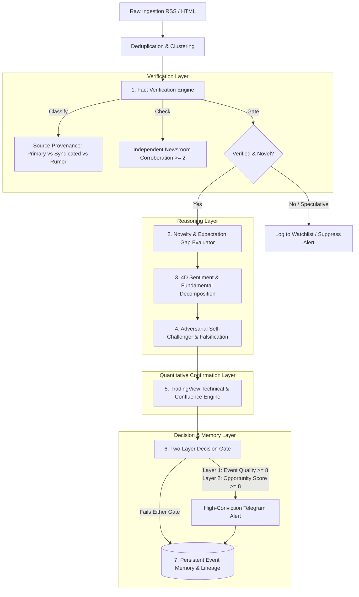

# Institutional Intelligence Optimization — Design Specification

**Date**: 2026-10-18  
**Status**: Approved & Under Implementation  
**Project Path**: `news-agent/`

---

## 1. Executive Summary & Objective

The objective of this upgrade is to transform the Market News Agent from a passive headline summarizer into an **institutional-grade, adversarial equity intelligence system**. 

The system directly addresses critical hedge fund and quant research requirements:
1. **Fact Verification Before Analysis**: Never build a thesis on an unverified rumor or recycled headline.
2. **Novelty & Expectation Gap**: Distinguish between *Good News*, *Unexpectedly Good News*, and *Priced-In News*.
3. **4-Dimensional Sentiment Decomposition**: Disentangle editorial tone from fundamental cash flow impact, market expectation surprise, and directional price response.
4. **Adversarial Self-Challenger**: Force the agent to argue against its own initial thesis, find alternative explanations, identify priced-in risks, and specify concrete falsification criteria.
5. **Two-Layer Decision Gates**: Decouple the **Event Information Quality Score** (evidence rigor, primary provenance) from the **Actionable Investment Opportunity Score** (surprise, asymmetric risk/reward).
6. **Quantitative Market Confirmation**: Cross-reference news catalysts against real-time technical indicators (TradingView RSI, SMAs, trend alignment, overbought/oversold extremes).
7. **Persistent Event Lineage & Memory**: Store structured event history to detect follow-ups, prevent duplicate alerts across cycles, and measure forward performance.

---

## 2. Architectural Blueprint



---

## 3. Core Subsystems & Technical Specifications

### 3.1 Subsystem 1: Fact Verification & Provenance Engine (`src/analysis/verification.py`)
- **Statement Classification**: Breaks claims into:
  - `VERIFIED_FACT`: Sourced to direct corporate filings (SEC 8-K/10-Q, TASE/MAYA, Fed, court dockets, official press wires).
  - `ATTRIBUTED_CLAIM`: Sourced to named on-the-record executives or named government officials.
  - `ANALYST_OPINION`: Street commentary, price target changes, non-binding ratings.
  - `ANONYMOUS_RUMOR`: Sourced to "sources familiar with the matter", "unnamed insiders", or unsourced blogs.
- **Corroboration Metric**: Counts distinct *independent* publisher domains. Wire syndication (e.g. Yahoo republishing Reuters) counts as a single source.
- **Fact Quality Gate**:
  - Unattributed rumors without primary confirmation receive `EventQualityScore <= 5/10`, automatically suppressing trade alerts.

### 3.2 Subsystem 2: Novelty & Expectation Gap Evaluator (`src/analysis/novelty.py`)
- **Tri-State Catalyst Typology**:
  1. `PRICED_IN_OR_RECYCLED`: Rehash of known guidance or anticipated event. Price has already drifted; reaction likely "sell the news".
  2. `IN_LINE_CONFIRMATION`: Validates previous trend but lacks fresh surprise factor.
  3. `GENUINE_SURPRISE`: Abrupt deviation from consensus or guidance (contract cancellation, surprise margin expansion, sudden CEO resignation).
- Evaluates against:
  - Prior guidance and consensus expectations.
  - Prior articles recorded in event memory.
  - Pre-publication price momentum.

### 3.3 Subsystem 3: 4-Dimensional Sentiment Decomposition (`src/analysis/sentiment_4d.py`)
Replaces monolithic sentiment with:
```python
class FourDimensionalSentiment(BaseModel):
    linguistic_sentiment: float      # -1.0 (bearish words) to +1.0 (bullish words)
    fundamental_impact: float        # -1.0 (damages cash flows) to +1.0 (expands free cash flow)
    expectation_surprise: float      # -1.0 (worse than expected) to +1.0 (beat expectations)
    price_implication: float         # -1.0 (likely drop) to +1.0 (likely surge)
    surprise_verdict: str            # BEAT, MISS, IN_LINE, UNEXPECTED_SHOCK
```

### 3.4 Subsystem 4: Adversarial Self-Challenger (`src/analysis/challenger.py`)
- Dedicated adversarial prompt execution:
  - **Bearish/Contrarian Thesis**: Force the model to build the strongest counter-argument against the prevailing consensus.
  - **Priced-In Risk Audit**: Identify why the stock might do the opposite of what the headline suggests.
  - **Confounding Attribution**: Is the move simply macro beta (e.g. rate cuts lifting all boats) rather than alpha?
  - **Falsification Threshold**: Exact financial data point or event that invalidates the trade hypothesis (e.g., "Next quarter capex guidance exceeding $14B").

### 3.5 Subsystem 5: Quantitative Technical Confirmation (`src/analysis/technical.py`)
- Real-time technical confluence from TradingView:
  - Daily RSI (Flags Overbought > 70 or Oversold < 30).
  - Trend Alignment: Price vs. SMA-50 and SMA-200.
  - TradingView Technical Consensus (Strong Buy, Buy, Neutral, Sell, Strong Sell).
  - Confluence Note: Identifies if technical setup supports or contradicts the fundamental news thesis.

### 3.6 Subsystem 6: Two-Layer Decision Gate (`src/analysis/decision_gate.py`)
1. **Layer 1: Event Information Quality Score (0–10)**:
   - Primary source presence (+3)
   - Independent corroboration (+2)
   - Novelty vs recycled (+3)
   - Factual certainty (+2)
2. **Layer 2: Actionable Investment Opportunity Score (0–10)**:
   - Magnitude of fundamental cash-flow alteration (+3)
   - Expectation surprise delta (+2)
   - Technical confluence alignment (+2)
   - Asymmetric risk/reward post-adversarial review (+3)
- **Gate Rule**: An alert is ONLY broadcast if `EventQuality >= 8` AND `OpportunityScore >= 8`.

### 3.7 Subsystem 7: Persistent Structured Event Lineage (`src/storage/sqlite.py`)
- New table `event_lineage`:
  - `event_id TEXT PRIMARY KEY`
  - `ticker TEXT`
  - `first_seen TIMESTAMP`, `last_updated TIMESTAMP`
  - `primary_source TEXT`, `all_sources TEXT`
  - `event_quality_score REAL`, `opportunity_score REAL`
  - `bullish_thesis TEXT`, `bearish_counter TEXT`
  - `invalidation_conditions TEXT`
  - `initial_price REAL`
  - `subsequent_return_1d REAL`, `subsequent_return_7d REAL`

---

## 4. Subagent Allocation & Verification Plan

- `financial-stock-expert`: Financial taxonomy, 4D sentiment decomposition prompts, expectation gap logic, adversarial challenger.
- `software-architect`: Pydantic data models (`models.py`), SQLite schema updates, two-layer gate contracts.
- `quant-researcher`: Quantitative market confirmation, technical indicator integration, RVOL/RSI threshold rules.
- `software-developer`: Full pipeline integration, new verification and decision gate modules, Telegram rich formatting.
- `qa-engineer`: Unit tests across all new modules and end-to-end integration tests (maintaining 100% pass rate).
