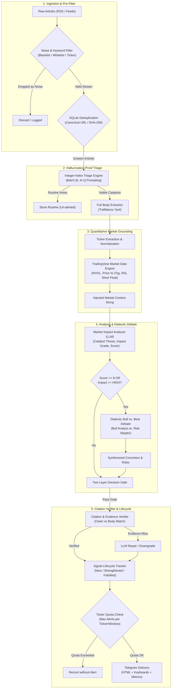

# Design Specification: Institutional Financial News Agent Optimizations

- **Date**: 2026-10-31
- **Status**: Proposed
- **Author**: Antigravity & Omer Lustig
- **Inspiration**: Analysis of 23 open-source financial agent and quant repositories (`mickeyinfoshan/financial-news-agent`, `DemonDamon/FinnewsHunter`, `RKiding/Awesome-finance-skills`, `Kumaran-Elumalai/ai-powered-financial-news-intelligence-system-using-langgraph`, `chonghao-t/ai-news-agent`, `mamuncseru/The-Sentinel`, `shner-elmo/TradingView-Screener`, `JerBouma/FinanceToolkit`, etc.)

---

## 1. Overview & Objectives

This specification defines the architectural enhancements to transition the `news-agent` system into an institutional-grade intelligence and alerting engine. 

### Core Objectives
1. **Zero-Hallucination Ingestion & Triage**: Eliminate hallucinated article selections and token bloat via enumerated integer-index triage and deterministic token pre-filtering.
2. **Quantitative Reality Grounding**: Incorporate live market context (intraday price action, relative volume surge, RSI(14), moving averages, short interest % of float) via TradingView market screener integration.
3. **Adversarial Dialectic Validation (Bull vs. Bear)**: Pressure-test high-conviction catalysts through a two-sided debate to expose priced-in risks, consensus traps, and thesis invalidation triggers.
4. **Factual Grounding & Citation Verification**: Ensure all catalyst assertions and numerical figures strictly match source article evidence with an automated self-repair loop.
5. **Catalyst Lifecycle Evolution & Ticker Fair-Share Quotas**: Track signals across time (`NEW` $\rightarrow$ `CORROBORATED` $\rightarrow$ `STRENGTHENED` / `FALSIFIED`) and prevent mega-cap news floods.

---

## 2. Architecture & Data Flow



---

## 3. Subsystem Specifications

### 3.1. Pre-Ingestion Filter & Ticker Disambiguation (`src/ingestion/prefilter.py`)
- **Noise Pre-filter**: Deterministic regex matching against known marketing/clickbait patterns:
  - Patterns: `r"3 stocks to buy", r"motley fool", r"sponsored:", r"top analyst upgrades", r"zacks investment ideas", r"partner content"`.
- **Ticker Validation Blacklist**: Filter common false-positive acronyms frequently misidentified as tickers:
  - Excluded set: `{"CEO", "CFO", "COO", "CTO", "AI", "EV", "US", "FED", "GDP", "SEC", "FDA", "IPO", "ETF", "CAGR", "EPS", "PE", "COVID", "WSJ", "PR", "LLC", "INC", "CORP"}`.
- **Config**:
  ```python
  @dataclass
  class PreFilterConfig:
      enabled: bool = True
      drop_sponsored: bool = True
      min_title_length: int = 15
      ticker_blacklist: set[str] = field(default_factory=lambda: {
          "CEO", "CFO", "COO", "CTO", "AI", "EV", "US", "FED", "GDP",
          "SEC", "FDA", "IPO", "ETF", "CAGR", "EPS", "PE", "COVID"
      })
  ```

### 3.2. Integer-Index Triage Engine (`src/analysis/triage.py`)
- **Mechanism**:
  - Batches unseen articles into groups of $N \le 20$.
  - Generates numbered list:
    ```
    [0] NVDA: Nvidia unveils new Rubin Blackwell Ultra architecture in Taiwan
    [1] General: 5 high-yield dividend stocks to retire early
    [2] LLY: FDA approves Eli Lilly new Alzheimer formulation
    ```
  - Prompt instructs the LLM:
    `"Return ONLY a JSON array of integer indices of articles containing genuine, company-specific market-moving news catalysts (e.g. [0, 2]). Return [] if none."`
  - Validates that returned integers are within range `0 <= i < len(batch)`.
  - Fully immune to hallucinated titles or URLs.
  - Fallback: If LLM call fails, falls back to existing keyword/heuristic triage.

### 3.3. TradingView Quantitative Market Data Engine (`src/analysis/market_data.py`)
- **Integration**:
  - Utilizes `tradingview_screener` (or lightweight REST query to TradingView's official screener endpoint).
  - Queries for each extracted ticker:
    - `close` (Current Price)
    - `change` (% Change 1D)
    - `volume` and `average_volume_10d_calc` $\rightarrow$ Computes Relative Volume (RVOL = `volume / avg_vol`).
    - `RSI` (14-period RSI on 1D).
    - `SMA50`, `SMA200` $\rightarrow$ % Distance from 50-DMA and 200-DMA.
    - `short_shares_percent_of_float` (Short interest % of float).
- **Prompt Injection**:
  Format injected into the `MarketImpactAnalyzer` prompt:
  ```
  [QUANTITATIVE MARKET CONTEXT FOR {TICKER}]
  - Current Price: $142.50 (+4.8% today)
  - Relative Volume (RVOL): 2.8x (Significant volume surge)
  - 14-Day RSI: 78.4 (Approaching Overbought territory)
  - Distance from 50 DMA: +12.3% | Distance from 200 DMA: +24.1%
  - Short Interest: 18.5% of float (Moderate short squeeze vulnerability)
  ```

### 3.4. Dialectic Debate Engine (`src/analysis/debate.py`)
- **Trigger**: Activated when initial confidence score $\ge 8$ or impact grade is `ImpactGrade.HIGH` or `ImpactGrade.CRITICAL`.
- **Protocol**:
  1. **Bull Case**: Summarizes upside catalyst transmission, multiple expansion potential, and unpriced growth drivers.
  2. **Risk Skeptic (Bear Case)**: Challenges the catalyst:
     - Is this already priced in given recent price run-up?
     - Are there regulatory, execution, or customer concentration risks?
     - Does valuation leave zero margin of safety?
  3. **Dialectic Synthesis**: Produces:
     - `net_conviction_score`: 1–10 (adjusted for skepticism).
     - `priced_in_risk_level`: `LOW` | `MEDIUM` | `HIGH`.
     - `invalidation_trigger`: Explicit condition under which the trade thesis fails (e.g. "Closing below 50 DMA of $132 or regulatory delay").

### 3.5. Factual Citation & Grounding Verifier (`src/analysis/citation.py`)
- **Verification Logic**:
  - Scans `catalyst_thesis`, `causal_chain`, and `recommendation` for:
    - Dollar amounts (`$X.Y billion/million`)
    - Percentages (`X.Y%`)
    - Specific regulatory items / dates.
  - Matches entities and numbers against extracted full article body text using fuzzy and regex matching.
  - **Self-Repair Loop (`FIX`)**:
    - If ungrounded figures are detected, issues a single prompt:
      `"The analysis stated '{claim}', but this is not grounded in the source text. Revise the thesis to strictly reflect the facts in the text."`
    - If still ungrounded after retry, drops confidence by 2 points and attaches an `[UNVERIFIED CLAIM WARNING]`.

### 3.6. Signal Lifecycle & Ticker Quota Limiter (`src/analysis/lifecycle.py`)
- **Signal Lifecycle**:
  - `NEW`: First time catalyst detected.
  - `CORROBORATED`: Multi-source corroboration passes (already in our corroborator).
  - `STRENGTHENED`: Subsequent distinct event confirms or expands prior thesis within 7 days.
  - `FALSIFIED`: Contradictory catalyst observed (e.g. initial M&A rumor followed by official termination).
- **Ticker Quota Limiter**:
  - Tracks alert timestamps per ticker in SQLite.
  - Rule: Max $K$ alerts per ticker within rolling $M$ hours (default: max 2 alerts per ticker in 6 hours).
  - If a 3rd alert triggers within 6 hours, it is only allowed if impact grade is `CRITICAL`. Otherwise recorded with `alerted=False` and reason `"TICKER_QUOTA_EXCEEDED"`.

---

## 4. Configuration Schema Updates (`src/config.py`)

New settings fields under `AgentSettings` and `FilterSettings`:

```python
class PreFilterSettings(BaseModel):
    enabled: bool = True
    drop_sponsored: bool = True
    ticker_blacklist: List[str] = [
        "CEO", "CFO", "COO", "CTO", "AI", "EV", "US", "FED", "GDP",
        "SEC", "FDA", "IPO", "ETF", "CAGR", "EPS", "PE", "COVID"
    ]

class MarketDataSettings(BaseModel):
    enabled: bool = True
    provider: str = "tradingview"  # "tradingview" | "yfinance" | "mock"
    fetch_timeout_sec: float = 3.0

class DebateSettings(BaseModel):
    enabled: bool = True
    min_confidence_to_debate: int = 8
    model: Optional[str] = None  # Uses primary model if None

class CitationSettings(BaseModel):
    enabled: bool = True
    auto_repair: bool = True

class QuotaSettings(BaseModel):
    enabled: bool = True
    max_alerts_per_ticker: int = 2
    rolling_window_hours: int = 6
```

---

## 5. Verification & Testing Strategy

1. **Unit Tests**:
   - `tests/test_prefilter.py`: Verify clickbait detection, ticker blacklist filtering, and valid headline passthrough.
   - `tests/test_integer_triage.py`: Verify integer indexing, range validation, error fallback, and zero hallucination.
   - `tests/test_market_data.py`: Mock TradingView API responses, verify calculation of RVOL, RSI, and prompt string injection.
   - `tests/test_debate.py`: Test Bull/Bear prompt generation and dialectic synthesis.
   - `tests/test_citation.py`: Test quote and number matching, detection of fabricated claims, and auto-repair routing.
   - `tests/test_lifecycle_quota.py`: Test ticker alert throttling, quota bypass for `CRITICAL` alerts, and signal state transitions.
2. **Regression Testing**:
   - Execute full test suite (`pytest`) to confirm all 431 existing tests continue passing without regression.
3. **End-to-End Pipeline Verification**:
   - Run pipeline run with mock news articles to verify seamless end-to-end flow with all new engines active.

---

## 6. Implementation Stages

- **Stage 1**: Ingestion Pre-filter & Ticker Disambiguation (`src/ingestion/prefilter.py`).
- **Stage 2**: Integer-Index Triage Engine (`src/analysis/triage.py`).
- **Stage 3**: Quantitative Market Data Engine with TradingView (`src/analysis/market_data.py`).
- **Stage 4**: Dialectic Debate Engine (`src/analysis/debate.py`).
- **Stage 5**: Citation & Evidence Verifier (`src/analysis/citation.py`).
- **Stage 6**: Signal Lifecycle & Ticker Quota Limiter (`src/analysis/lifecycle.py`).
- **Stage 7**: Pipeline integration, configuration wiring, and end-to-end regression validation.
